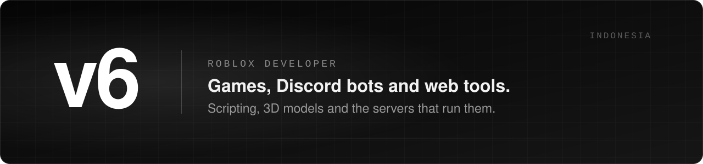
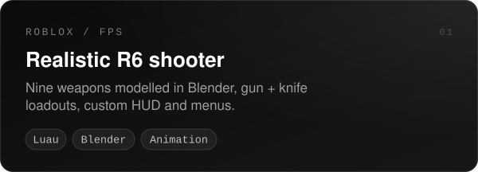
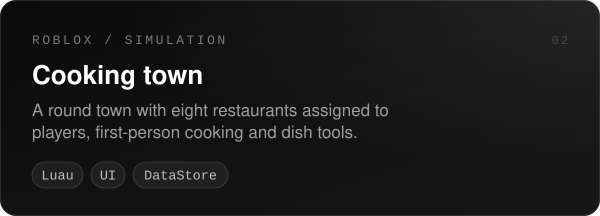
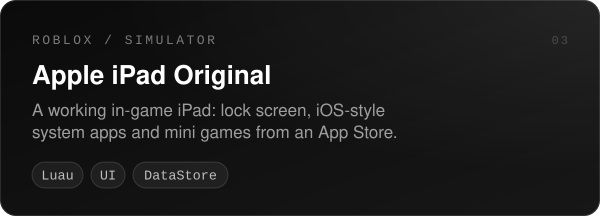
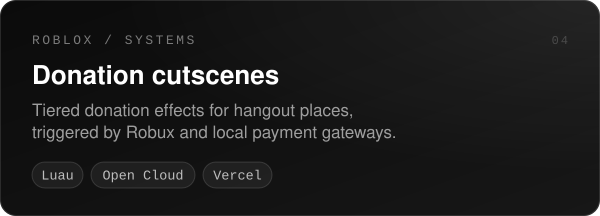
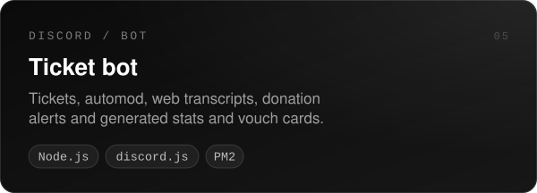
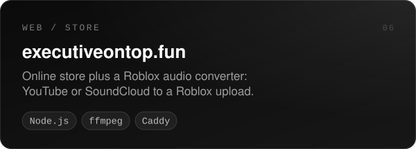

 

I make Roblox games and the stuff around them: Discord bots for the communities, web tools, and the servers they run on. Most of my work is in private repos, so here is an overview of what I have been building.

 

### Projects

  
  

  
  

  
  

### Open source

- [**anarchy-voice**](https://github.com/fw6s/anarchy-voice) - temporary Discord voice channels with a button control panel and chat commands

### Tools

 
